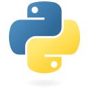
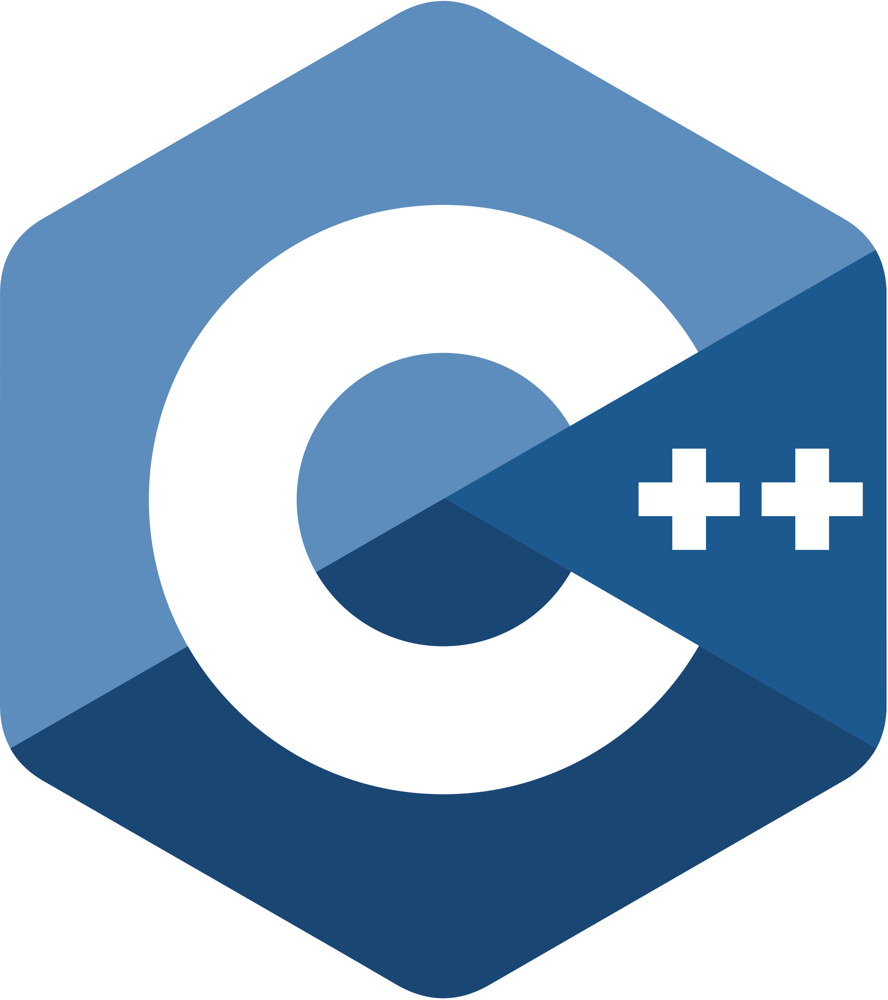

<h1 align="center">Hi, I'm Sean 👋</h1>
<h3 align="center">Backend & Full-Stack Developer — Python, JavaScript, PHP, and infrastructure automation with Docker, Ansible, and Kubernetes</h3>

  

---

### 🔧 What I work on

I build and maintain backend services and full-stack applications, with a strong focus on automation and reliable infrastructure — containerizing services with Docker, provisioning with Ansible, and orchestrating with Kubernetes. Comfortable across the stack: from application code in Python, JavaScript, and PHP, to the Linux systems, databases, and CI/CD pipelines that run it.

### 🚀 Featured Projects

- **[plex-director-mcp](https://github.com/HoneyBearTech/plex-director-mcp)** — MCP server for Claude Desktop that troubleshoots Plex and Servarr (Sonarr/Radarr) stacks.
- **[platform](https://github.com/HoneyBearTech/platform)** — Collection of quick-start templates for provisioning environments with Ansible and Docker.
- **[DockerApps](https://github.com/HoneyBearTech/DockerApps)** — Curated set of Docker Compose files for self-hosting containerized services.

### 🤝 Open-source contributions

I fix bugs and send pull requests to projects I use, mostly Home Assistant integrations and self-hosting tools.

  
  
  

  

<!-- CONTRIBUTIONS:START -->

<b>Latest 10 pull requests</b>

- 🟣 Merged · [Use the new comprehension scoping in every function (#919 follow-up)](https://github.com/custom-components/pyscript/pull/924) — `custom-components/pyscript`
- 🟣 Merged · [Require lowercase index in processing mode values](https://github.com/Kometa-Team/Quickstart/pull/1982) — `Kometa-Team/Quickstart`
- 🟣 Merged · [Add the --timings option to the Kometa run options](https://github.com/Kometa-Team/Quickstart/pull/1981) — `Kometa-Team/Quickstart`
- 🟣 Merged · [Reject divider characters that break the Kometa run command](https://github.com/Kometa-Team/Quickstart/pull/1980) — `Kometa-Team/Quickstart`
- 🟣 Merged · [Fix mal_all genre source lost on import and export](https://github.com/Kometa-Team/Quickstart/pull/1979) — `Kometa-Team/Quickstart`
- 🟣 Merged · [Fix outdated README docker run example and Logscan scope note](https://github.com/Kometa-Team/Quickstart/pull/1978) — `Kometa-Team/Quickstart`
- 🟣 Merged · [Recognize TVDb, TMDb and IMDb IDs in Plex NFO Series agent GUIDs](https://github.com/Kometa-Team/Kometa/pull/3880) — `Kometa-Team/Kometa`
- 🟣 Merged · [Support super().prop for pyscript properties](https://github.com/custom-components/pyscript/pull/923) — `custom-components/pyscript`
- 🟣 Merged · [Docs: how to read an attribute's old and new values (#433)](https://github.com/custom-components/pyscript/pull/922) — `custom-components/pyscript`
- 🟣 Merged · [Let trigger expressions start and end with blanks and span lines (#617)](https://github.com/custom-components/pyscript/pull/921) — `custom-components/pyscript`

<!-- CONTRIBUTIONS:END -->

### 🏆 Achievements

  

### 📈 Contribution graph

<picture>
  <source media="(prefers-color-scheme: dark)" srcset="profile-3d-contrib/profile-night-rainbow.svg" />
  <source media="(prefers-color-scheme: light)" srcset="profile-3d-contrib/profile-green-animate.svg" />
  
</picture>

### 🛠️ Languages & Tools

  

