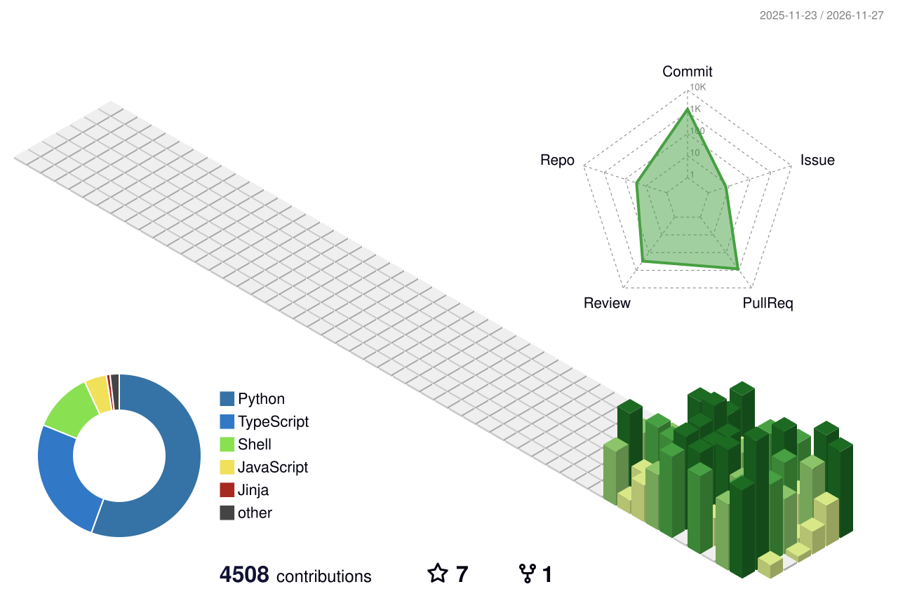

<h1 align="center">Hi, I'm Sean 👋</h1>
<h3 align="center">Backend & Full-Stack Developer — Python, JavaScript, PHP, and infrastructure automation with Docker, Ansible, and Kubernetes</h3>

  

---

### 🔧 What I work on

I build and maintain backend services and full-stack applications, with a strong focus on automation and reliable infrastructure — containerizing services with Docker, provisioning with Ansible, and orchestrating with Kubernetes. Comfortable across the stack: from application code in Python, JavaScript, and PHP, to the Linux systems, databases, and CI/CD pipelines that run it.

### 🚀 Featured Projects

- **[plex-director-mcp](https://github.com/HoneyBearTech/plex-director-mcp)** — MCP server for Claude Desktop that troubleshoots Plex and Servarr (Sonarr/Radarr) stacks.
- **[platform](https://github.com/HoneyBearTech/platform)** — Collection of quick-start templates for provisioning environments with Ansible and Docker.
- **[DockerApps](https://github.com/HoneyBearTech/DockerApps)** — Curated set of Docker Compose files for self-hosting containerized services.

### 🤝 Open-source contributions

I fix bugs and send pull requests to projects I use, mostly Home Assistant integrations and self-hosting tools.

  
  
  

<!-- CONTRIBUTIONS:START -->

<b>Latest 10 pull requests</b>

- 🟢 Open · [Store nested classes themselves on the outer class (#875)](https://github.com/custom-components/pyscript/pull/907) — `custom-components/pyscript`
- 🟢 Open · [Restore the scope when a class body raises](https://github.com/custom-components/pyscript/pull/906) — `custom-components/pyscript`
- 🟣 Merged · [Handle unknown Beckett advertisements](https://github.com/custom-components/ble_monitor/pull/1636) — `custom-components/ble_monitor`
- 🟢 Open · [Fix lights marked as manually controlled right after turning on](https://github.com/basnijholt/adaptive-lighting/pull/1667) — `basnijholt/adaptive-lighting`
- 🟢 Open · [Show the tracked airport in the airport input, not a rejected code](https://github.com/AlexandrErohin/home-assistant-flightradar24/pull/362) — `AlexandrErohin/home-assistant-flightradar24`
- 🟢 Open · [Keep the exact position when a tracked flight is found by search](https://github.com/AlexandrErohin/home-assistant-flightradar24/pull/361) — `AlexandrErohin/home-assistant-flightradar24`
- 🟢 Open · [fix(sensor): keep "9am" lowercase in observation sensor names (fixes #287)](https://github.com/bremor/bureau_of_meteorology/pull/362) — `bremor/bureau_of_meteorology`
- 🟢 Open · [fix(setup): retry setup when BOM cannot be reached (fixes #282)](https://github.com/bremor/bureau_of_meteorology/pull/361) — `bremor/bureau_of_meteorology`
- 🟢 Open · [fix(sensor): handle missing UV end time in UV forecast summary (fixes #284)](https://github.com/bremor/bureau_of_meteorology/pull/360) — `bremor/bureau_of_meteorology`
- 🟢 Open · [test(adur-worthing): build fixture dates from today so the parser tests stop expiring](https://github.com/robbrad/UKBinCollectionData/pull/2350) — `robbrad/UKBinCollectionData`

<!-- CONTRIBUTIONS:END -->

### 📈 Contribution graph

<picture>
  <source media="(prefers-color-scheme: dark)" srcset="profile-3d-contrib/profile-night-rainbow.svg" />
  <source media="(prefers-color-scheme: light)" srcset="profile-3d-contrib/profile-green-animate.svg" />
  
</picture>

### 🛠️ Languages & Tools

